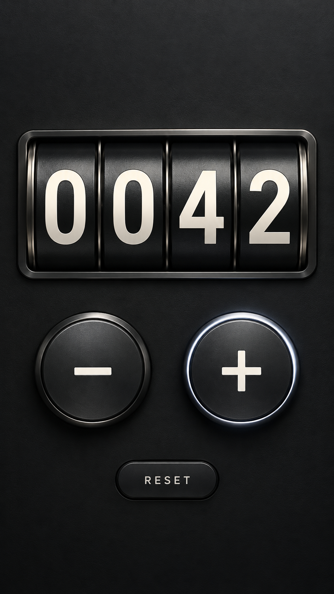

<div align="center">

# Click Counter

**Механический характер. Один экран. Ничего лишнего.**

Минималистичный счётчик для Android с тёмным металлическим интерфейсом.

[Русский](README.md) · [English](README.en.md)


[](https://github.com/Renamekk/Click-Counter/releases/tag/v1.0.0)
[](LICENSE)

### [Скачать APK](https://github.com/Renamekk/Click-Counter/releases/latest)

Android 8.0 и новее · Без рекламы · Без аккаунта · Без разрешений

</div>

<div align="center">



<sub>Концепт интерфейса</sub>

</div>

## Только счётчик

Четыре механических барабана, мягкая подсветка и анимация нажатий. Все действия доступны на одном экране:

| Кнопка | Действие |
| :---: | --- |
| **+** | Прибавить один |
| **-** | Убавить один |
| **RESET** | Сбросить до 0000 |

Диапазон **0000-9999**. На границах значение остаётся в допустимом диапазоне. Текущее число сохраняется на устройстве и восстанавливается при следующем запуске.

Истории, статистики и дополнительных экранов нет. Сеть и сервер для работы не нужны.

## Установка

1. Откройте [последний релиз](https://github.com/Renamekk/Click-Counter/releases/latest) и скачайте файл `.apk`.
2. Откройте его на телефоне. При запросе Android разрешите установку из выбранного браузера или файлового менеджера.
3. Установите приложение и начинайте считать.

В релизе также доступен файл `.sha256` для проверки целостности APK.

## Сборка из исходников

Нативное приложение на Java без сторонних библиотек интерфейса. Используются **Gradle 9.6.1**, **Android Gradle Plugin 9.0.0**, **Android SDK Platform 36** и **Build Tools 36.0.0**. Сборка проверена с **JDK 24**; исходный код использует Java 17.

На Windows с установленными JDK и Android SDK:

```powershell
.\build-apk.ps1
```

Если зависимости уже загружены:

```powershell
.\build-apk.ps1 -Offline
```

Скрипт находит SDK через `ANDROID_HOME`, `ANDROID_SDK_ROOT` или `%LOCALAPPDATA%\Android\Sdk`, выполняет release-сборку и lint, проверяет подпись и сохраняет результат:

```text
artifacts/
  Click-Counter-1.0.0.apk
  Click-Counter-1.0.0.apk.sha256
```

При первой сборке создаётся локальный ключ подписи. **Сохраните `.signing/` и `signing.properties`**: они нужны для выпуска обновлений с той же подписью. Эти файлы исключены из Git.

## Проверка версии 1.0.0

`assembleRelease` и `lintRelease` выполнены успешно: 0 ошибок lint, 13 предупреждений. Подпись APK и выравнивание ZIP проверены. Проверка интерфейса и поведения на реальном телефоне пока не выполнена.

Основной экран: [`MainActivity.java`](app/src/main/java/app/clickcounter/MainActivity.java).

## Лицензия

[MIT](LICENSE) · Copyright (c) 2026 Renamekk.
